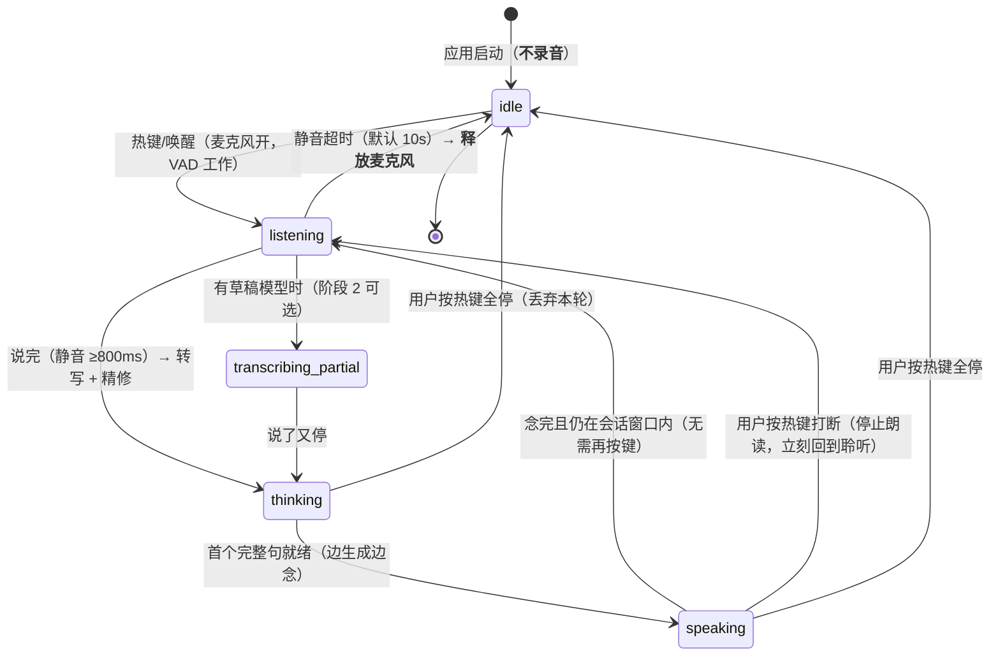

# 语音交互排期：语音输入 + 连续语音对话（2026-10-16）

> 性质：**排期与交互形态设计**（选型调研见 `VOICE_IO_RESEARCH.md`，输入侧实施设计见 `VOICE_VIDEO_INPUT_PLAN.md`）
> 本文只记三件事：**① 排期与前置 ② 连续语音交互的状态机 ③ 与呈现协议的接口（念 + 看同步）**
> 一句话：语音**输出**已经通了（`speech` 出口 + 179 个系统音色 + 试听 + `shouldSpeak`），
> 现在要补的是**耳朵**，以及补完之后**怎么连续对话**。

---

## 1. 现状：一半已通，缺的是"耳朵"

| 环节 | 现状 | 证据 |
| :--- | :--- | :--- |
| **语音输出** | ✅ 已通：`speech` 出口（`say`，走统一命令管线）+ 音色下拉/示例/试听 + 该不该念由宿主判（`shouldSpeak`） | 真机 live：179 音色 / 19 中文；`cargo test --lib surface::tests::live_` |
| **出口协同** | 🟡 设计已定：呈现单元 `sync`（语音与浮层同时起、同时收、一起打断） | `docs/PRESENT_PROTOCOL.md` §6 |
| **语音输入（耳朵）** | ❌ 无 | 选型已定：官方 `sherpa-onnx` crate（Silero VAD + SenseVoice + 标点） |
| **连续对话** | ❌ 无 | 本文 §3 |
| **前置** | ❌ **本机 `index.crates.io` 不可达**，新增 Rust 依赖前必须先配稀疏镜像（`~/.cargo/config.toml`，本机尚无该文件） | 实测：rsproxy / tuna / ustc 的 sparse index 均 200 |

**TTS 侧的三条实测事实（2026-10-16，决定架构）**：

| 测什么 | 结果 | 影响 |
| :--- | :--- | :--- |
| `say -o` 合成耗时（5 / 12 / 42 字） | **2.79 / 2.71 / 2.93s**（**与字数无关**） | 固定启动开销 ≈2.8s → 「逐句各起一个 `say`」不可行（句间各卡 2.8s） |
| 音频时长（同上） | 0.82 / 2.25 / 8.20s → 语速 **≈4.9 字/秒** | 浮层存活时长可估算（±10%） |
| 直接朗读 5 字总耗时 | 3.66s（≈0.82s 音频 + 2.8s 开销） | **首响延迟 ≈2.8s**：可接受但不好 → 侧车能把这段省掉 |

---

## 2. 排期（阶段 0~3）

| 阶段 | 内容 | 人日 | 前置 | 验收（真机） |
| :--- | :--- | :-: | :--- | :--- |
| **0. 前置打通** | ① 配 cargo 稀疏镜像（**唯一一次要动用户主目录**）② `Info.plist` 加 `NSMicrophoneUsageDescription` + 权限探测命令 ③ `voice` 模块骨架 + `cpal` 采集 + 真实电平事件 ④ 接 Silero VAD | 0.5~1 | 用户同意改 `~/.cargo/config.toml` | 按住热键说一句 → 波形跟随真实音量；松手落 wav；拒权限时给"去系统设置"引导 |
| **1. push-to-talk 闭环** | SenseVoice（离线非流式）+ 标点模型；模型准备状态机（下载→校验→加载，含进度/失败分类/重试/可取消）；识别结果**进草稿不自动发送** | 2~3 | 阶段 0 + **首次下载数百 MB 模型** | 说「道生一，看看今天改了哪些文件」→ 1.5s 内草稿出现（**不发出去**）；`lsof` 证明无音频设备常驻 |
| **2. 连续语音对话**（本次重点） | 半双工回合制：一次唤醒/一次热键 → **多轮问答不用再按键**；朗读→回到聆听→静音超时退出；任意时刻一键全停（声音+浮层同时收） | 1~2 | 阶段 1 | 连问 3 轮全程不碰键鼠；朗读中按热键 **1 秒内**静音；静默 10s 自动退出且麦克风释放 |
| **2b. 同步呈现**（可并行） | 呈现单元编排：朗读时浮层亮、读完浮层淡出（±1.5s）、同单元一起收；念摘要/看细节分工 | 1 | 无（纯宿主逻辑） | 录屏：开始差 <300ms、结束差 <1.5s、按停无残留 |
| **3. 免手与真全双工**（按需） | 唤醒词（sherpa-onnx KWS 3M zh-en）+ 热词偏置（项目术语）+ **AEC**（`VoiceProcessingIO`）→ 真打断；可选云端高质量档 | 3~5 | 阶段 2 | 说唤醒词即进入会话；**能打断正在朗读的回复** |

> **总盘子：阶段 0+1 ≈ 3~4 人日；阶段 2+2b ≈ 2~3 人日；阶段 3 视需要。**
> 唯一硬前置是**镜像 + 首次模型下载**（阶段 0/1 的卡点），其余都是本地可做的活。

---

## 3. 连续语音交互：状态机与三条判定

### 3.1 状态机



四条设计约束（都不是偏好，是硬约束）：
1. **`idle` 不录音**：隐私红线（本项目明确不做常驻录音），也是 CPU 与电池的底线；
2. **`speaking` 期间暂停采集（半双工）**：外放时麦克风会听到自己的声音 → 误触发。
   真 AEC 排在阶段 3（`VoiceProcessingIO`），在此之前**不假装能全双工**；
3. **一键全停**：全局热键 → 停止 TTS（kill）+ 丢弃草稿 + 浮层收起 + 回到 `idle`（一个动作解决三件事）；
4. **退出即释放**：`idle` 要关麦克风（可验证：`lsof` 无音频设备 / 系统指示灯灭）。

### 3.2 三条判定（参数与理由）

| 判定 | 参数 | 理由 |
| :--- | :--- | :--- |
| **说完** | VAD 静音 **800ms**（可配 400~1500） | 太短：换气就断句；太长：交互像卡住 |
| **会话窗口** | 念完后 **10s** 内可继续说（可配 5~30），超时回 `idle` | 连续对话"自然"的关键：不用反复按键；但也别**永远**举着麦克风 |
| **误触发** | 二次判定：静音段 ≥0.5s **且** 有效语音 ≥0.3s 才算一轮 | 咳嗽/桌椅声不该触发一轮 LLM 调用（**按话轮计费**的方言下这条直接省钱） |

### 3.3 与 LLM 主循环的接法

- 转写 → **草稿**（可撤销的一次插入），用户可改；`speaking` 结束回到 `listening` 后，
  **新一轮的转写仍进草稿**，由「连续模式」自动提交（**这是唯一会自动提交的路径**，且必须由用户显式开启）；
- 每一轮都走**现有**护栏：预算护栏 / 回合上限 / 危险命令审批 / 静默开关 —— 语音**不是特权通道**；
- 朗读内容来自 `speech` 出口（同一份 IR），所以「念的」与「浮层显示的」天然一致。

---

## 4. 与呈现协议的接口（让"同步展现"落地）

```
                         ┌──────────────── 呈现单元（同一个 id）────────────────┐
  LLM 流式输出 ──► 句子切分 ──► speech 出口（TTS）  ──► 念摘要
       │                 └──► hud 出口（IR 上屏）   ──► 看细节（数字/图表/多行）
       │                          ▲
       └── 收尾 ──► buildFinishIr ─┘     两者同起同收（PRESENT_PROTOCOL §6）
```

| 交互点 | 做法 |
| :--- | :--- |
| **同时开始** | 先 emit `surface://hud`（毫秒级），再 spawn TTS；两者之间无 IO 串联 |
| **同时结束** | `auto` 浮层存活 = **朗读时长 + 1s**；v1 用估算（字数 ÷ 4.9 + 2.8s 开销），v1.1 用真实回调 |
| **念到哪句** | v1：估算时间轴 → 逐句高亮；v1.1：`willSpeakRangeOfSpeechString` 真实进度 |
| **一键停** | 全局热键 → 同单元 `onInterrupt: "all"`（声音 + 浮层一起收） |
| **聆听/朗读状态** | HUD 胶囊上的状态点：`聆听中`（波形来自**真实电平**）/`朗读中`/`思考中` —— 连续对话时用户不必盯着窗口 |
| **静默/勿扰** | 只摘掉语音，浮层照旧（用户关声音 ≠ 不想看一眼） |

**为什么这层要放进协议而不是写在语音模块里**：语音只是「出口之一」。
今天把"同起同收"写死在 `voice.rs`，明天加 IM 推送就得再写一遍。
放在协议层（`display-ir.ts` 的 `sync` 意图 + `surface.rs` 的编排），所有出口自动受益。

---

## 5. 成本与护栏（语音把「按任务」变成「按话轮」）

| 风险 | 护栏 |
| :--- | :--- |
| 误识别触发一轮 LLM（真花钱） | ①转写**进草稿不自动发**（默认）②二次判定（§3.2）③连续模式的**自动提交**必须用户显式开启 |
| 话轮变多 → token 消耗放大 | 复用现有**预算护栏 + 回合上限**；`token 预算`告警在语音模式下同样生效 |
| ASR 与 LLM 抢 CPU（6 核无 GPU） | 识别**并发 = 1**；INT8；限定线程数；空闲释放模型（照 `local_runtime` 的 `IDLE_KILL_SECS` 模式） |
| 深夜乱念 / 乱冒 | 勿扰时段（`PRESENT_PROTOCOL` §4）+ 静默模式 + 语音总闸（**默认关**） |

---

## 6. 前置与风险（均已实测/已确认，不重复调研）

| 项 | 事实 | 对策 |
| :--- | :--- | :--- |
| **crates.io 不可达** | `index.crates.io` HTTP 000；rsproxy / tuna / ustc 的 sparse index 均 200 | 阶段 0 先配 `~/.cargo/config.toml`（**需用户点头：动的是主目录**） |
| sherpa-onnx 原生库 | 构建时从 GitHub Releases 取预编译 `osx-x64` 库（GitHub 可达 ✅） | 首次构建慢一次，之后缓存 |
| 麦克风权限 | Tauri v2 macOS 必须在 `Info.plist` 写用途说明，否则进程被终止 | 阶段 0 一并做 + 权限探测命令 + 引导文案 |
| 模型体积 | SenseVoice + 标点数**百 MB 级** | **不塞安装包**：首次使用时下载到应用数据目录，UI 给进度；支持手动放入 `models/` |
| 蓝牙耳机 | macOS 上切双向音频会降质（Handy 已记录的已知问题） | UI 提示：输出用耳机、输入选内置麦克风 |
| 许可 | sherpa-onnx Apache-2.0；SenseVoice 权重有署名条款 | 「关于 → 第三方声明」清单 |
| 回声 | 外放时麦克风听到 TTS | 阶段 2 半双工；阶段 3 才上 AEC |

---

## 7. 不做

- ❌ 常驻录音 / 后台听（隐私红线，也是 CPU 底线）；唤醒词模式必须**显式开启**且有明显状态指示；
- ❌ 默认把音频送云端（本地优先）；
- ❌ 在阶段 2 假装能全双工/打断（没 AEC 就是做不到，说了会变成"打断无效"的 bug 报告）；
- ❌ 语音走特权通道（审批/预算/沙箱一律照旧）；
- ❌ 把逐字卡拉 OK 高亮当 v1 目标（先句子粒度）。

---

## 8. 待实测（用数据定模型，不靠感觉选）

| 指标 | 方法 | 用途 |
| :--- | :--- | :--- |
| RTF / CPU 占用 | 同一段 10s 中文音频，各模型 wall time ÷ 时长；`ps` 采样 | 定默认模型 |
| 首字延迟（流式草稿） | 说话开始 → 首个草稿字 | 决定阶段 2 要不要上流式模型 |
| 终稿延迟 | 说完 → 定稿落地 | 验收线 1.5s |
| 中文准确率 | 自录 20 句（含项目术语、中英混说、数字）人工统计字错率 | 定默认档 |
| 朗读同步误差 | v1 估算 vs 真实音频时长的偏差 | 决定 P-A7 侧车要不要上 |

---

## 9. 建议顺序（与 `/docs/PRESENT_PROTOCOL.md` 的关系）

1. **先做呈现协议（P-A1~A3）**：零新依赖、不动系统配置、今天就能做；它让"结果怎么送达"从三套变一套；
2. **再做语音阶段 0+1**：卡点在**镜像 + 首次模型下载**（需要用户点头）；
3. **然后阶段 2+2b（连续对话 + 同步呈现）**：这时"念"和"看"已经是同一条管线，同步是免费的；
4. **最后阶段 3**：唤醒词与真打断（AEC）——这是"贾维斯感"最后一块，也是最贵的一块。
